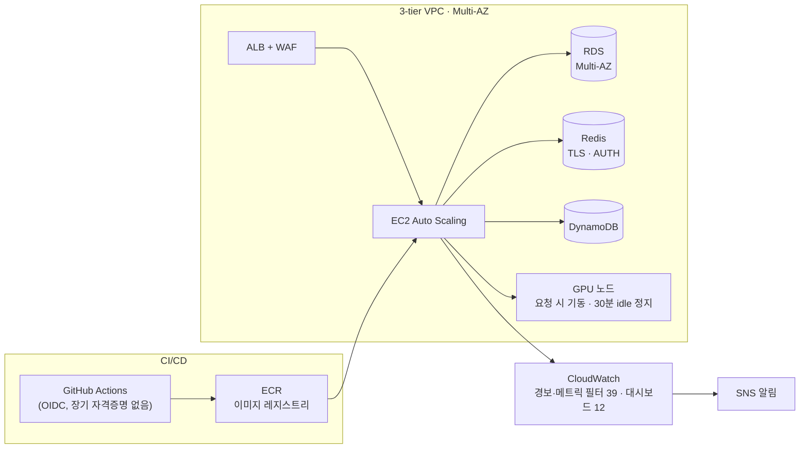

# 김남해 — 인프라 하는 풀스택

**Backend · DevOps · Security** · 실서비스 인프라를 단독 운영하며, 실측 수치로 결과를 증명합니다.

### 실측 성과

| 지표 | 개선 전 | 개선 후 |
|---|---|---|
| 트래픽 10배 급증 대응 | 에러율 최대 2.9% | **에러율 0.008~0.05% · p95 0.3초** |
| 에러 가시성 | 무경보 (22.6만 건 잠복) | **경보·메트릭 필터 39개 · 대시보드 12개** |
| 배포 시간 | 수동 배포 16분 | **CI/CD 8분** |
| 실시간 음성 통화 GPU 서빙 | 노드당 동시 통화 1건 · GPU 사용률 20% 이하 | **노드당 4건 · 5분 통화 GPU 원가 −69%** |
| CI 파이프라인 | PR 한 번 약 95분 | **좁은 PR 8~10분 · main 랜딩 약 1분** |
| 보안 | superuser 단일 접속 · 수기 대응 | **DB 역할 4개 분리 · ISMS-P 자체 감사 72건 · SIEM 구축** |

모든 수치는 CloudWatch · CloudTrail · GitHub Actions · Cost Explorer 실측값이며, 조건은 [포트폴리오](https://team.haeyounglab.com)의 각 사례에 적혀 있습니다.

**Case Study** · [경보가 없으면 사고가 없는 것이 아니라, 보이지 않을 뿐이다](https://team.haeyounglab.com/Namhae_Kim/case-observability) — 무경보 실서비스에서 무장애 운영까지 3개월의 기록

### 운영 중인 AWS 인프라 (스테이징·prod 환경을 Terraform으로 구축)

### 대표 작업

| 작업 | 무엇을 했나 | 스택 | 링크 |
|---|---|---|---|
| **무경보 실서비스를 관측·CI/CD·FinOps까지 코드로** | 에러 22.6만 건 표면화, 배포 16→8분, 고정비 월 −$78, prod 환경 리소스 165개 코드화 | AWS · Terraform · CloudWatch · k6 | [사례](https://team.haeyounglab.com/projects/aws-infra-modernization) |
| **실시간 음성 통화 GPU 서빙** | TTS 전역 락 병목을 실측으로 찾아 노드당 동시 통화 1→4건, 통화당 원가 −69%, 24/7 노드를 요청 시 기동으로 | Python · L4 GPU · nginx · Lambda | [사례](https://team.haeyounglab.com/projects/voice-gpu-serving) |
| **인메모리 엔진 상태 외부화·수평확장 설계** | OOM을 k6로 재현한 뒤 RDS·DynamoDB로 무중단 영속화, 동시 세션 한 자릿수→피크 116, 후보 9안·5축 점수화 | Node.js · PostgreSQL · DynamoDB | [사례](https://team.haeyounglab.com/projects/stateful-engine-scaling) |
| **ISMS-P 감사와 자격증명 체계 정비** | 136개 엔드포인트 다중 에이전트 감사로 72건 확정, DB 역할 분리, OIDC로 장기 키 0, 출시 컴플라이언스 | Express · PostgreSQL · OIDC | [사례](https://team.haeyounglab.com/projects/endpoint-security-audit) |
| **실내건축 기업 홈페이지 (외주, 운영 중)** | Next.js + .NET 8 Lambda + 사설망 RDS를 Terraform으로, 월 비용 −30%, state 소실 사고 무중단 복구 | Next.js · .NET 8 · Terraform | [사례](https://team.haeyounglab.com/projects/o2-corporate-site) |
| **R&D 오토노트** | 협업 로그를 벡터로 거르고 RAG로 연구노트 생성, LLM 토큰 비용 −60% (종료) | FastAPI · pgvector · LangChain | [사례](https://team.haeyounglab.com/projects/rd-autonote) |

전체 15개는 [team.haeyounglab.com/projects](https://team.haeyounglab.com/projects)에 있습니다.

### 활동

  
  

**Portfolio** · [team.haeyounglab.com](https://team.haeyounglab.com) · **Contact** · tksz0613@gmail.com
