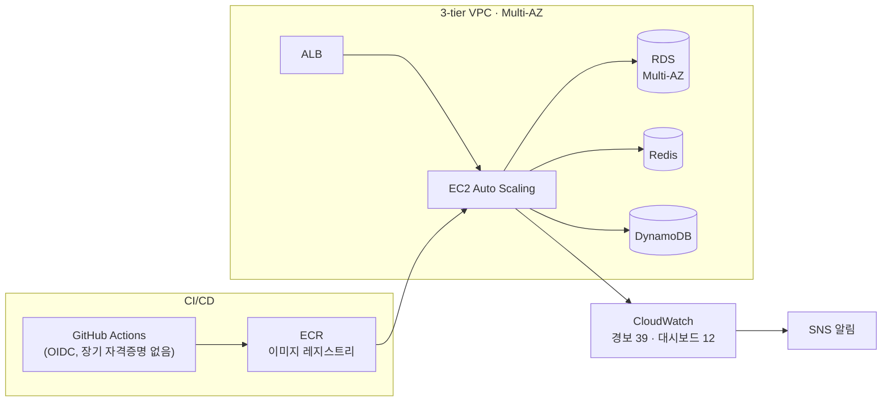

# 김남해 — 인프라 하는 풀스택

**Backend · DevOps · Security** · 실서비스 인프라를 단독 운영하며, 실측 수치로 결과를 증명합니다.

### 실측 성과

| 지표 | 개선 전 | 개선 후 |
|---|---|---|
| 트래픽 10배 급증 대응 | 에러율 최대 2.9% | **에러율 0.008~0.05% · p95 0.3초** |
| 배포 시간 | 수동 배포 16분 | **CI/CD 8분** |
| 에러 가시성 | 무경보 (22.6만 건 잠복) | **경보·메트릭 필터 39개 · 대시보드 12개** |
| 보안 | 수기 대응 | **SIEM 구축 · ISMS-P 자체 감사 (취약점 72건 식별)** |

### 운영 중인 AWS 인프라 (스테이징 전체를 Terraform으로 단독 구축)

### 대표 프로젝트

| 프로젝트 | 어떤 문제를 풀었나 | 스택 | 링크 |
|---|---|---|---|
| **PlanIt** | 스크럼 작성이 며칠이면 끊기는 문제를 주기 자동화·봇 연동으로 | NestJS · Next.js · PostgreSQL | [planit.haeyounglab.com](https://planit.haeyounglab.com) |
| **R&D 오토노트** | 연구 증빙이 협업 툴에 흩어져 소명이 어려운 문제를 RAG 파이프라인으로 | FastAPI · pgvector · LangChain | [상세 보기](https://team.haeyounglab.com/projects/rd-autonote) |
| **팀 포트폴리오 플랫폼** | 이력 데이터를 실측 지표·다이어그램 중심으로 보여주는 사이트 | Next.js · Mermaid | [team.haeyounglab.com](https://team.haeyounglab.com) |

### 활동

  
  

**Portfolio** · [team.haeyounglab.com/Namhae_Kim](https://team.haeyounglab.com/Namhae_Kim) · **Contact** · tksz0613@gmail.com
